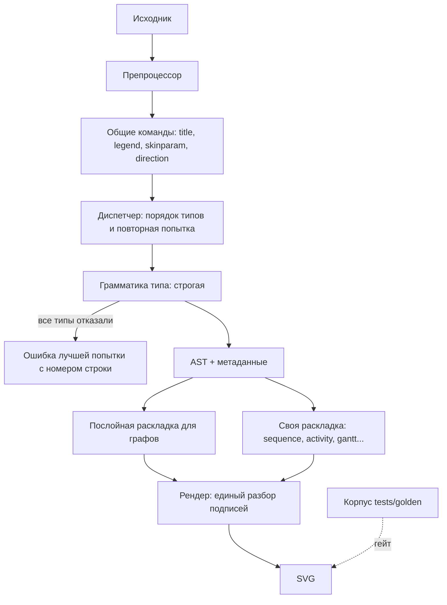

# План: plantuml-rs как рендерер заметок Yttri

**Дата:** 2026-10-31
**Статус:** 🚧 В работе
**Приоритет:** P0
**Спецификация:** [2026-10-31-notes-renderer-readiness.md](../specs/2026-10-31-notes-renderer-readiness.md)

## Цель

Схема либо отрисована со всем содержимым и читаемо, либо заменена понятной ошибкой;
рендер не может уронить приложение; Yttri рисует PlantUML этим движком без сети.

## Текущее состояние

- `detect_diagram_type` выбирает один тип по подстрокам (`"map "`, `"o{"`, `"object "`).
  Ошибка выбора даёт ошибку разбора или пустую диаграмму, второго шанса нет.
- Общие команды (`title`, `header`, `legend`, `caption`, `skinparam`, `scale`,
  `left to right direction`, `hide`) описаны в каждой грамматике по-своему или не описаны.
- Текст подписей обрабатывается в нескольких местах: `\n` работает в сообщениях и не
  работает в заметках; creole и C4 частично.
- Каждая графовая диаграмма раскладывается своим кодом; `class/sugiyama.rs` самый полный.

## Архитектура решения



## Решение

### Корпус и гейт
- `tests/golden/cases/` — наборы с префиксами `ref_*` (справочник), `feat_*` (возможности),
  `real_*` (реалистичные); `tests/golden/hostile/` — враждебные входы.
- `tests/golden/exceptions.txt` — `имя-кейса: причина`.
- `crates/plantuml-core/tests/gate_tests.rs` — новый тест: нет ошибок и потерянных слов,
  по кейсам с отрисованным эталоном; кейс с ошибочным эталоном должен дать у нас ошибку.

### Контракт ошибок (псевдокод)

```pseudo
Error::Parse { line, text, reason }       // строка исходника после препроцессора
Error::Unsupported { kind }               // @startditaa, @startlatex, ...
Error::TooDeep { limit }
Error::EmptyDiagram                       // текст есть, элементов нет
```

## Фазы

### Фаза 0: Корпус и гейт (4 ч)
- [x] Импорт 128 примеров справочника → `scripts/import-doc-cases.py`, `tests/golden/cases/ref_*`
- [x] 99 примеров и 13 схем → `tests/golden/cases/feat_*`, `real_*`; враждебные → `tests/golden/hostile/`
- [x] Эталоны → `tests/golden/fetch_references.py`, `tests/golden/reference/`
- [x] Гейт с храповиком числа нарушений → `crates/plantuml-core/tests/gate_tests.rs`, `tests/golden/gate_baseline.txt`
- **Проверка:** `cargo test -p plantuml-core --test gate_tests` печатает сводку и фиксирует исходный уровень.

### Фаза 1: Безопасность встраивания (3 ч)
- [x] Аллокатор за возможностью `memory-limit` → `crates/plantuml-core/{Cargo.toml,src/lib.rs,src/alloc.rs}`, `crates/plantuml-wasm/Cargo.toml`, `tests/alloc_tests.rs`
- [x] Предел вложенности до разбора → `crates/plantuml-parser/src/lib.rs`, ошибка `TooDeep`
- [x] Враждебный корпус на потоке 2 МБ с таймаутом → `crates/plantuml-core/tests/robustness_tests.rs`
- deviated: ссылки переехали в фазу 4: `[[…]]` сейчас вообще не разбирается, выводится текстом, опасного вывода нет
- deviated: корпус лежит в `tests/golden/corpus/`, а не в `cases/`: `golden_tests` держит геометрию старых 24 кейсов, ему нельзя падать на новых
- **Проверка:** `cargo test -p plantuml-core --test robustness_tests`; сборка без возможности не содержит `global_allocator`.

### Фаза 2: Диспетчер и общие команды (6 ч)
- [x] Порядок типов и повторная попытка, отказ с лучшей ошибкой → `crates/plantuml-parser/src/lib.rs`
- [x] Общие команды вынесены из грамматик → `crates/plantuml-parser/src/common.rs`; значения кладутся в существующий `DiagramMetadata`
- [x] Титул, шапка, подвал, легенда, подпись выводятся для всех типов → `crates/plantuml-renderer/src/decorations.rs`; свой код заголовков в движках sequence, gantt, timing удалён
- [x] Неявное создание элементов из связей, ошибка пустой диаграммы → `crates/plantuml-parser/src/parsers/class.rs`, `crates/plantuml-core/src/pipeline.rs`
- [x] `Unsupported` для типов вне объёма; `@start*` без `@startuml` и схема без тегов → `crates/plantuml-parser/src/lib.rs`
- **Проверка:** гейт: падает число ошибок разбора, `Animal <|-- Dog` рисуется.

### Фаза 3: Синтаксис по типам (16 ч)
- [ ] [P] Sequence → `grammars/sequence.pest`, `parsers/sequence.rs`, `plantuml-layout/src/sequence/`
- [ ] [P] Class, object, ER → `grammars/{class,object,er}.pest`, `parsers/{class,object,er}.rs`
- [ ] [P] Activity → `grammars/activity.pest`, `parsers/activity.rs`, `plantuml-layout/src/activity/`
- [ ] [P] State → `grammars/state.pest`, `parsers/state.rs`, `plantuml-layout/src/state/`
- [ ] [P] Component, deployment, usecase → `grammars/{component,usecase}.pest`, `parsers/{component,usecase}.rs`
- [ ] [P] Gantt, mindmap, WBS, YAML, JSON, salt, network, archimate, timing → соответствующие грамматики
- [ ] Просмотр всех веток `_ => {}` в `parsers/*.rs`: разобранное попадает в AST и в вывод
- **Проверка:** гейт зелёный по ошибкам разбора для всех `ref_*`, `feat_*`, `real_*`.

### Фаза 4: Подписи (6 ч)
- [ ] Единый разбор подписи: `\n`, creole, цвет, размер, таблицы, списки, спрайты → `crates/plantuml-renderer/src/`, `crates/plantuml-layout/src/text.rs`
- [ ] Ссылки `[[…]]` разбираются, в вывод только http, https, mailto → `crates/plantuml-renderer/src/svg_renderer.rs`
- [ ] `!define` с заменой в теле, `<$sprite>`, `<&icon>`, `<:emoji:>` → `crates/plantuml-preprocessor/src/`, `crates/plantuml-stdlib/`
- [ ] C4 рисуется с заливкой и подписями → `crates/plantuml-stdlib/`, `crates/plantuml-layout/src/component/`
- **Проверка:** гейт: 0 потерянных слов; сверка `real_*` глазами с эталоном.

### Фаза 5: Послойная раскладка (16 ч)
- [ ] Ядро: ранги network simplex, порядок median+transpose, координаты, маршрут рёбер → `crates/plantuml-layout/src/graph/`
- [ ] Перевод class, object, ER, state, component, usecase на ядро → соответствующие `engine.rs`
- [ ] Кластеры: пакеты, вложенные состояния → `crates/plantuml-layout/src/graph/`
- [ ] Проверка читаемости по корпусу → `crates/plantuml-core/tests/readability_tests.rs`
- **Проверка:** тест читаемости; `golden_report` показывает снижение суммарного расхождения.

### Фаза 6: Тема и дополнительные типы (5 ч)
- [ ] Тёмная тема → `crates/plantuml-themes/`, `crates/plantuml-core/src/options.rs`
- [ ] `@startregex`, `@startebnf`, `@startchart` → новые грамматики и раскладки
- **Проверка:** тест тёмной темы на контраст; гейт по этим кейсам зелёный.

### Фаза 7: Встраивание в Yttri (5 ч)
- [ ] Отдельная ветка и PR в Yttri по его правилам; задача в `.yttri/project.db`
- [ ] Команда рендера на бэкенде, поток со стеком 2 МБ и `catch_unwind` → `frontend/src-tauri/src/modules/`, git-зависимость на зафиксированный коммит
- [ ] Блок заметки и чата → `UmlBlockNode.tsx`, `ChatMessageRenderer.tsx`; ошибка показывает исходник и причину
- [ ] Убрать `plantuml-encoder`, `PLANTUML_SERVER`, предупреждение настроек, обновить справку и `exportPdf`
- **Проверка:** сборка Yttri, живой прогон без сети, скриншоты в обеих темах.

### Фаза 8: Завершение (2 ч)
- [ ] README, CHANGELOG, `docs/AUDIT.md`, гейты CI: fmt, clippy, no-panic, MSRV, WASM
- **Проверка:** полный прогон локально.

## Трассировка

| Требование | Фаза |
|------------|------|
| FR-001, FR-002 | 0 ✅ механизм, зелёный гейт после фаз 2–4 |
| FR-003, FR-004 | 2 |
| FR-005 | 2, 3 |
| FR-006 | 4 |
| FR-007, FR-008 | 1 ✅ |
| FR-009 | 7 |
| FR-010, FR-011 | 5 |
| FR-012, FR-020 | 6 |

## Риски

| Риск | Вероятность | Влияние | Что делаем |
|------|-------------|---------|------------|
| Строгий разбор ломает схемы, рисовавшиеся с потерями | Высокая | Среднее | Это намеренно (D-002); гейт ловит случаи, где эталон рисует |
| Экспоненциальный откат PEG при повторных попытках | Средняя | Высокое | Враждебный корпус с таймаутом, вложенность ограничена до разбора |
| Эталоны сервера меняются с его версией | Средняя | Низкое | Эталоны закоммичены, версия в `metadata.json` |
| Новая раскладка ухудшает уже точные кейсы | Средняя | Среднее | Храповик `baseline.json`; переводим типы по одному |

## Решения плана

| # | Вопрос | Решение | Дата |
|---|--------|---------|------|
| PD-001 | Как надёжно определить тип | Как PlantUML: пробуем грамматики по порядку, эвристика задаёт только порядок. Цена — лишние попытки разбора при ошибке, на обычных схемах их нет | 2026-10-31 |
| PD-002 | Общие команды | Отдельный проход до грамматик: одна реализация вместо шестнадцати | 2026-10-31 |
| PD-003 | Отдельный крейт для раскладки или `crates/plantuml-layout/src/graph/` | Модуль в существующем крейте | 2026-10-31 |
| PD-004 | Зависимость для графа | Своя реализация: нужны этапы dot и поддержка кластеров, готовые крейты их не дают; остаёмся Pure Rust | 2026-10-31 |
| PD-005 | Эталоны на сервере | Только тестовые схемы, ничего из заметок | 2026-10-31 |
| PD-006 | Отправка на GitHub | Коммиты локально; `3b0f189` с постом не отправлен владельцем, его судьбу решает владелец | 2026-10-31 |

## Технический долг

| # | Описание | Фаза | Приоритет |
|---|----------|------|-----------|
