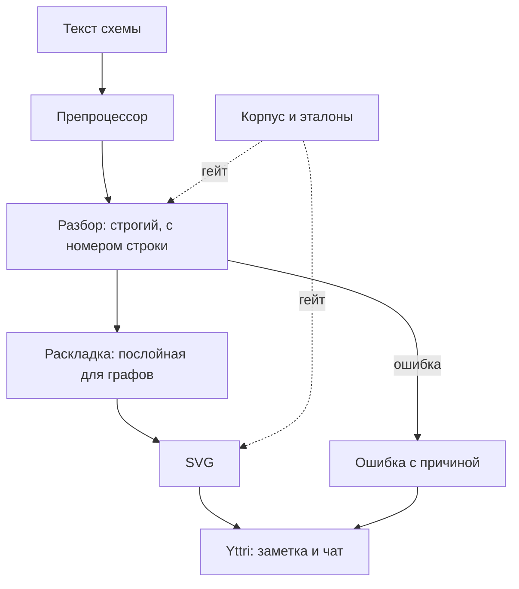

# Спецификация: plantuml-rs как рендерер заметок Yttri

**Дата:** 2026-10-31
**Приоритет:** P0
**Тип:** Доработка существующего

## 1. Проблема

Yttri рисует PlantUML-блоки заметок через публичный plantuml.com: текст схемы уходит
третьей стороне, без сети вместо схемы битая картинка. Владелец выбрал заменить это
собственным движком plantuml-rs, но версия 0.2.0 к этому не готова. Замер 2026-10-31
против настоящего PlantUML:

- 99 примеров по одной возможности: 61 верно, 24 ошибки разбора, 14 молчаливых потерь;
- 13 реалистичных схем: 5 ошибок, 5 с потерей или порчей содержимого, полный текст в 3;
- `Animal <|-- Dog` даёт успех и пустую диаграмму: потеря незаметна пользователю;
- `#[global_allocator]` в библиотеке навязывает встраивающему приложению лимит 1 ГиБ и abort;
- 1000 вложенных `alt` на стеке 2 МБ роняют весь процесс переполнением стека.

## 2. Цель

Любая схема из заметки либо отрисована со всем содержимым и читаемо, либо заменена
понятной ошибкой с номером строки. Рендер не может уронить приложение, и после
проверки Yttri рисует PlantUML этим движком без обращения к сети.

## 3. Текущее состояние

- Разбор: `crates/plantuml-parser/src/lib.rs` (`detect_diagram_type`, по эвристикам),
  грамматики `grammars/*.pest`, разбор `parsers/*.rs`; в них 143 ветки `_ => {}`,
  где разобранное правило может молча отбрасываться.
- Раскладка: `crates/plantuml-layout/src/*`, у class, state, component, usecase, ER своя
  упрощённая раскладка; `docs/AUDIT.md` называет отсутствие порта dot главным остатком
  расхождения геометрии.
- Сверка: `tests/golden/` и `crates/plantuml-core/tests/golden_tests.rs`, эталоны
  plantuml.com, храповик `baseline.json`; 24 кейса, все на простых примерах.
- Аллокатор: `crates/plantuml-core/src/alloc.rs`, объявлен в `lib.rs`.
- Yttri: `frontend/src/renderer/components/editor-v2/nodes/blocks/UmlBlockNode.tsx` (сервер),
  `components/ui/ChatMessageRenderer.tsx` (только код), подсказка в настройках ассистента.

## 4. Сценарии

### Сценарий 1: Обычная схема рисуется полностью (P0)
**Как** автор заметки **хочу** писать обычный PlantUML **чтобы** видеть всё, что написал.

- [ ] Дано: пример из корпуса сверки, который настоящий PlantUML отрисовывает. Когда
  рендерим. Тогда результат успешный и каждое слово подписей эталона есть в SVG.

### Сценарий 2: Неподдержанное видно сразу (P0)
**Как** автор **хочу** видеть причину, **чтобы** не считать неполную схему верной.

- [ ] Дано: строка, которую движок не умеет отобразить. Когда рендерим. Тогда ошибка
  с номером и текстом строки, а не SVG без этого содержимого.
- [ ] Дано: тип диаграммы вне поддержки. Тогда ошибка называет этот тип.

### Сценарий 3: Схема не роняет приложение (P0)
**Как** разработчик Yttri **хочу** вызывать движок в своём процессе **чтобы** чужая
заметка не могла его положить.

- [ ] Дано: приложение со своим распределением памяти. Когда подключаем библиотеку.
  Тогда лимит памяти процесса не меняется.
- [ ] Дано: враждебный вход из корпуса на потоке со стеком 2 МБ. Тогда за 5 с возвращён
  результат или ошибка, процесс жив.

### Сценарий 4: Схема читается (P1)
**Как** автор **хочу** ровную раскладку **чтобы** схемой можно было пользоваться.

- [ ] Дано: схема корпуса. Тогда узлы не пересекаются, подписи и фигуры лежат внутри
  области SVG, рамки охватывают своё содержимое, стрелка идёт к своей фигуре.
- [ ] Суммарное расхождение габаритов с эталоном по корпусу ниже значения на начало
  работы и зафиксировано храповиком.

### Сценарий 5: Yttri рисует без сети (P0)
**Как** пользователь Yttri **хочу** видеть схему офлайн **чтобы** текст заметки никуда
не уходил.

- [ ] Дано: заметка с PlantUML и отключённая сеть. Тогда схема отрисована, запросов к
  plantuml.com нет.
- [ ] Дано: ошибка рендера. Тогда видны исходник и причина.
- [ ] Блок PlantUML в чате рисуется так же; в обеих темах схема читается; предупреждение
  «не рендерится» из настроек убрано.

## 5. Функциональные требования

### Обязательно (P0)
- **FR-001**: Корпус сверки расширен до трёх наборов: 128 примеров с `@start` из
  `docs/PLANTUML_LANGUAGE_REFERENCE.md` и `docs/SYNTAX.md`, 99 примеров по возможностям,
  реалистичные схемы. Эталоны хранятся в репозитории, тесты не ходят в сеть.
- **FR-002**: Жёсткий гейт: для каждого кейса, у которого эталон отрисован, нет ошибок
  разбора и потерянных слов. Исключения перечислены в файле с причиной, каждое должно
  быть ошибкой с понятным текстом, а не молчаливой потерей.
- **FR-003**: Нераспознанная строка всегда даёт ошибку с номером строки. Разобранное
  правило не отбрасывается молча.
- **FR-004**: Определение типа диаграммы не дробит одну схему и не даёт пустой результат
  при наличии содержимого.
- **FR-005**: Закрыты пробелы синтаксиса, найденные гейтом, по всем поддерживаемым типам.
- **FR-006**: Перенос `\n`, creole, `!define`, sprite и прочая разметка в подписях
  обрабатываются единообразно и не попадают в вывод сырым текстом. C4 из stdlib рисуется.
- **FR-007**: Глобальный аллокатор только за необязательной возможностью, по умолчанию
  выключен; сборка WASM её включает.
- **FR-008**: Глубина вложенности ограничена, превышение даёт ошибку. Весь разбор,
  раскладка и рендер проходят враждебный корпус на стеке 2 МБ за 5 с.
- **FR-009**: Yttri использует движок для блоков заметки и чата, зависимость
  `plantuml-encoder` и обращения к plantuml.com удалены.

### Важно (P1)
- **FR-010**: Общая послойная раскладка для графовых диаграмм (class, state, component,
  usecase, ER, object), реализующая этапы dot: ранги, порядок, координаты, маршрут рёбер.
- **FR-011**: Проверки читаемости (сценарий 4) выполняются тестом по всему корпусу.
- **FR-012**: Тёмная тема как опция рендера.

### Желательно (P2)
- **FR-020**: `@startregex`, `@startebnf`, `@startchart`.

## 6. Нефункциональные требования

- **Производительность**: схема до 100 элементов рендерится не дольше 50 мс в release.
- **Безопасность**: `render()` не обращается к файлам, сети и окружению; текст экранируется;
  гиперссылки выводятся только со схемами http, https и mailto.
- **Совместимость**: Pure Rust, сборка `wasm32-unknown-unknown`, MSRV проекта, гейты CI
  (fmt, clippy, запрет паник) зелёные.

## 7. Архитектура

## 8. Вне объёма

- Байтовая и пиксельная идентичность с PlantUML: метрики шрифтов зависят от среды, цель
  остаётся измеряемой храповиком.
- `@startditaa`, `@startlatex`, `@startmath`: дают ошибку с названием типа.
- Удалённые `!include` и чтение файлов из `render()`.
- Публикация на crates.io.

## 9. Решения

| # | Вопрос | Решение | Дата |
|---|--------|---------|------|
| D-001 | Новый стенд сверки или существующий | Расширяем `tests/golden`: эталоны, храповик и скрипт уже есть | 2026-10-31 |
| D-002 | Неизвестная строка: пропустить или ошибка | Ошибка. Часть новых схем перестанет рисоваться вовсе, зато неполная схема не выглядит верной | 2026-10-31 |
| D-003 | Как встроить в Yttri: нативно или WASM | Нативный крейт на бэкенде: логика на стороне Rust, как `doc-render`, и работает для экспорта. Защита от падения обеспечена FR-007 и FR-008 | 2026-10-31 |
| D-004 | Цель раскладки | Этапы dot и проверяемая читаемость, без обещания пиксельной идентичности: она упирается в метрики шрифта (`docs/AUDIT.md`) | 2026-10-31 |
| D-005 | Подгонять ли гейт под 99 примеров | Нет: примеры из справочника по языку входят в гейт, чтобы правки не подгонялись под один набор | 2026-10-31 |
| D-006 | Ссылки `[[…]]` | Выводим только http, https, mailto: заметка может прийти извне | 2026-10-31 |
| D-007 | Что с утечкой до готовности | Заменяем сервер только готовым движком в одном изменении Yttri, промежуточного состояния без картинки пользователи не получают | 2026-10-31 |

## 10. Критерии успеха

- [ ] Гейт FR-002 зелёный на всём корпусе, список исключений содержит только типы вне объёма.
- [ ] Набор из 13 реалистичных схем: 13 без ошибок и потерь, проверено сравнением
  с эталоном глазами.
- [ ] Враждебный корпус: нет падений процесса на стеке 2 МБ, каждый вход не дольше 5 с.
- [ ] Yttri собран с движком: заметка рисуется при выключенной сети, в логах сети нет
  plantuml.com, `plantuml-encoder` удалён.
